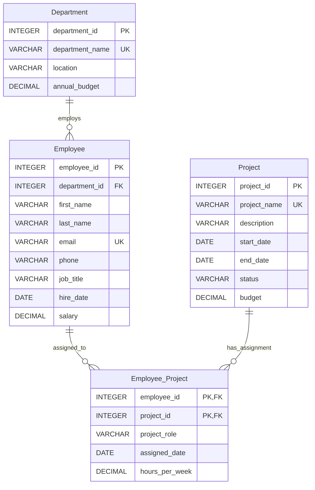

# Employee Management System

## Entity-relationship diagram

An employee belongs to one department; a department can employ many employees.
Employees and projects have a many-to-many relationship, resolved by
`Employee_Project`. Its composite primary key prevents assigning the same
employee to the same project more than once.

## Table definitions and keys

| Table | Columns and definitions | Primary key | Foreign keys |
|---|---|---|---|
| `Department` | `department_id INTEGER NOT NULL`; `department_name VARCHAR(100) NOT NULL UNIQUE`; `location VARCHAR(100) NOT NULL`; `annual_budget DECIMAL(14,2) NOT NULL CHECK (annual_budget >= 0)` | `department_id` | None |
| `Employee` | `employee_id INTEGER NOT NULL`; `department_id INTEGER NOT NULL`; `first_name VARCHAR(60) NOT NULL`; `last_name VARCHAR(60) NOT NULL`; `email VARCHAR(254) NOT NULL UNIQUE`; `phone VARCHAR(30)` (optional); `job_title VARCHAR(100) NOT NULL`; `hire_date DATE NOT NULL`; `salary DECIMAL(12,2) NOT NULL CHECK (salary >= 0)` | `employee_id` | `department_id` references `Department(department_id)` |
| `Project` | `project_id INTEGER NOT NULL`; `project_name VARCHAR(150) NOT NULL UNIQUE`; `description VARCHAR(500)` (optional); `start_date DATE NOT NULL`; `end_date DATE` (optional); `status VARCHAR(20) NOT NULL` (Planned, Active, On Hold, or Completed); `budget DECIMAL(14,2) NOT NULL CHECK (budget >= 0)` | `project_id` | None |
| `Employee_Project` | `employee_id INTEGER NOT NULL`; `project_id INTEGER NOT NULL`; `project_role VARCHAR(100) NOT NULL`; `assigned_date DATE NOT NULL`; `hours_per_week DECIMAL(5,2) NOT NULL CHECK (hours_per_week > 0 AND hours_per_week <= 168)` | `(employee_id, project_id)` | `employee_id` references `Employee(employee_id)`; `project_id` references `Project(project_id)` |

### Referential and data constraints

- Department names, employee emails, and project names are unique.
- Each employee must reference an existing department.
- Each project assignment must reference an existing employee and project.
- A project end date, when supplied, cannot precede its start date.
- Budgets and salaries cannot be negative; weekly assignment hours must be
  greater than zero and at most 168.

## Sample data

The accompanying [employee_management.sql](./employee_management.sql) script
creates all four tables and inserts sample rows:

| Table | Sample row count |
|---|---:|
| `Department` | 5 |
| `Employee` | 20 |
| `Project` | 10 |
| `Employee_Project` | 28 |

The script uses explicit integer IDs and standard SQL data types, so it does
not rely on a database-specific auto-increment feature. Run it against an
empty database; it creates the tables before inserting the data.